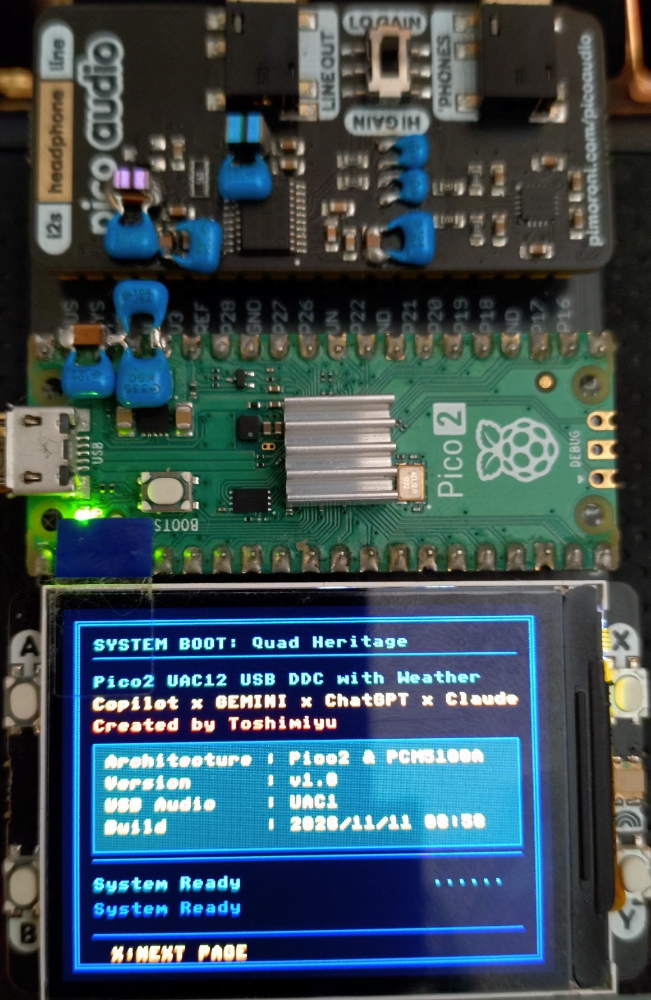
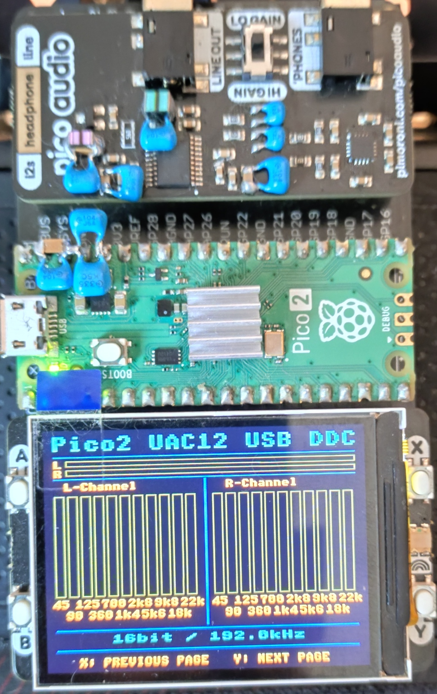
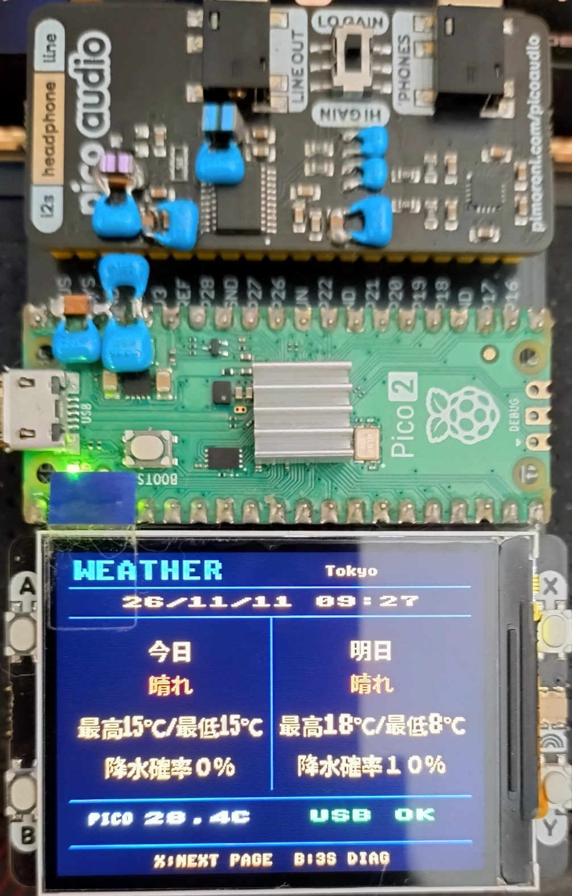
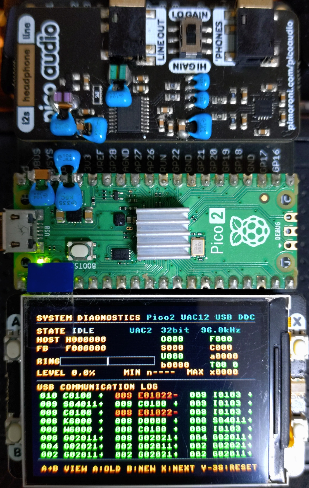

# Pico2_UAC12_USBDDC_Weather（TinyUSB UAC1/UAC2 切替対応）

[English](README_EN.md) | [日本語](README.md)

## 概要

本プロジェクトは、従来の `Pico2_UAC12_USBDDC` から派生した、RP2350（Raspberry Pi Pico 2）用のUSB-DDCファームウェアです。

TinyUSBをベースにUSBオーディオ機能を再構成し、ビルド時にUSB Audio Class 1.0（UAC1）と2.0（UAC2）を選択できます。USBクラス層を分離しながら、共通のオーディオ処理コアを使用します。

### 派生版の主な機能

- 従来のUAC1 / UAC2、I²S出力、FFT表示と診断機能を継承
- 今日・明日の予報、日時、USB状態、RP2350内部温度を表示するWeather画面
- 利用者が選択した地域の気象庁予報と日時をUSB CDC経由で送信するWindows向け天気サービス
- Weather画面と診断画面のBボタン長押しによる切替
- 天気サービスのUSB切断検出、COMポート再接続、取得済み予報の再送
- 診断モードでのUSB CDC診断ログ出力

### オーディオ・診断機能

オーディオ処理では、引き続き以下を行いません。

- オーバーサンプリング（NOS）
- FIRフィルター処理
- サンプルレート変換

USB受信データはリングバッファーへ格納する前に、PCMサンプル幅（16/24/32-bit）とステレオフレーム境界を検証します。不正な形式や境界を検出した場合はTinyUSBのOUT FIFOを破棄して再同期し、CDC診断ログと統計カウンターに記録します。破棄後も通常の状態機械を維持し、内部状態名`UNDERFLOW_FATAL`（診断画面のSTATE表示では`UDF!`）中は有効データの蓄積を待って既存の再バッファリング経路で復帰します。

また、PCM入力の隣接サンプルから急峻な変化の候補を計測します。しきい値超過時は`PCM_CLICK_CANDIDATE`として記録しますが、音声データや再生ゲインは変更しません。正常な高周波信号でも記録される可能性があるため、これはクリック確定ではなく調査用の診断です。

11バンドFFTアナライザー、リアルタイムレベルメーター、バッファー水位計などの表示機能を維持・改善しています。

**ビルド確認済み環境**

- Raspberry Pi Pico SDK v2.3.1
- Toolchain 15_2_Rel1

## バージョン情報

### v1.0 — 初版リリース

`Pico2_UAC12_USBDDC` の派生版として、Weather画面とPC側天気サービスを追加しました。実機では、動作中のUSB抜き差し後の復帰、サービス起動中の診断画面への切替とWeather画面への復帰、サービス停止後のターミナルソフトによるCDCログ確認を確認しています。

## 設計目標

- オーディオ信号経路を簡素化する
- 不要なソフトウェアDSP処理をなくす
- オーバーサンプリング、FIRフィルター、サンプルレート変換を行わない信号経路にする
- USB Audio Classごとのコードを分離し、保守性を高める
- UAC1 / UAC2で共通のオーディオエンジンを使う
- トラブルシューティング用のリアルタイム診断機能を提供する

PCM5100Aは内部でオーバーサンプリングとデジタルフィルター処理を行うため、本ファームウェアではソフトウェアのオーバーサンプリングとFIRフィルターを使用しません。

オーバーサンプリング、FIRフィルター、サンプルレート変換は行いませんが、出力には固定ゲイン比0.80を適用し、さらにUAC1/UAC2の音量設定（0～-64dB）およびミュートをソフトウェアで反映するため、PCMサンプルの値は変化します。

USBミュート／解除は入力PCMに約5msのリニアなゲインランプを適用します。音量変更は従来どおり即時反映します。リングやDMAに既に格納された音声は変更しないため、実際の出力への反映はバッファー分遅れます。入力異常やアンダーフロー時の自動ミュート／フェードは行いません。

## 特長

- USB Audio Class 1.0 / 2.0 切替対応
- Async Feedback Endpointによる非同期フィードバック制御
- サンプルレートに応じた約6msのプリフィル後にI²S再生とPIフィードバック制御を開始
- リアルタイムバッファー水位計
- A特性補正付き11バンドFFT表示
- オーバーサンプリングなし（NOS）
- FIRフィルターなし
- オーバーサンプリング、FIRフィルター、サンプルレート変換を行わないI²S出力
- DMA + PIOによる低遅延I²S転送
- RP2350デュアルコア対応
- PICO_AUDIO_PACK対応
- Pico Display Pack 2.0対応
- Weather画面での日時・今日と明日の天気・気温・降水確率・USB状態・Pico内部温度の表示

## ハードウェア写真

### システム全体

本プロジェクトの実機写真です。Weather画面には設定した気温の地点名も表示しています。

> **組み立て時の重要注意（向き・配置）**
>
> Treedixドーターボードに各モジュールを取り付ける際は、接続の向きと、DACボード（Pico Audio Pack）およびPico Display Pack 2.0の並び順を必ず下のシステム全体写真で確認してください。向きや並び順を逆にすると、オーディオジャックなどの部品が物理的に干渉し、正しく取り付けられない場合があります。配線・半田付けを始める前に、写真と照らし合わせて配置を確認してください。

#### 起動画面



#### 再生画面



#### WEATHER画面



#### 診断画面



Pico 2 + Pico Audio Pack（PCM5100A）+ Pico Display Pack 2.0

## 表示仕様（Pico Display Pack 2.0）

起動後はGADGET MODE（標準）になります。GADGET MODEではXボタンで再生・Weather・起動画面を切り替えます。診断画面はDIAG MODE専用で、通常の画面切替では表示されません。Weather画面または診断画面でBボタンを3秒長押しすると、GADGET MODEとDIAG MODE（診断画面）を切り替えます。Weather画面では3・2・1のカウントダウンを表示し、切替前に離すとキャンセルします。

音楽再生中の負荷を抑えるため、Weather画面では変更されたデータ項目だけを描画し、日時は変更された文字だけを更新します。罫線や見出しは画面切替時以外は描き直しません。動的項目の更新開始は最大約24回/秒とし、矩形の消去や文字描画を小さな処理に分割して、音声バッファーに余裕があるときに間隔を空けて実行します。

### Weather画面

日時、今日と明日の天気・最高／最低気温・降水確率、USB受信状態、Pico内部温度を表示します。天気は種類ごとに色分けされます。日時と予報はPCサービスから受信し、内部温度はPico自身で取得します。未取得の気温は`--`で表示します。

`WEATHER`の右側には、設定した気温の地点の英語名を半角で表示します。天気・降水確率の予報地域とは異なる場合があります。長い名前は末尾を省略します。地点名は画面に表示されるため、写真などを共有する際はご注意ください。

USB状態は有効なデータの受信前が`WAIT`、受信後が`OK`、最後の有効なデータから5分経過すると`LOST`です。これは天気データの受信状態であり、USBオーディオの状態そのものではありません。

### 診断モードの操作

診断画面では以下の操作ができます。

- A：古いUSBログへ移動
- B：新しいUSBログへ移動
- A+B：USBログと直近の音声状態履歴を切り替え
- Yを3秒長押し：診断カウンターとUSBイベントログをリセット（押している間、画面下にカウントダウンを表示）

USBイベントログは起動時から記録され、Diag画面では直近64件を確認できます。USBバスリセット/切断、記述子要求、構成完了/解除、UAC制御要求などを記録します。Diag画面でYを3秒長押しすると、診断値とUSBイベントログをリセットします。周期的な診断統計とCDCのCSV出力はDIAG MODE中だけ有効です。画面モードにかかわらず、音声再生とFFT処理は継続します。

### USB CDC診断ログ

CDCインターフェースはCMakeの`USB_BRINGUP_LEVEL=3`で有効になります。GADGET MODEではCOMポート経由で天気コマンドを受信し、診断画面を隠して診断ログを出力しません。DIAG MODEでは診断画面を表示してCDCへ以下のCSVログを出力し、天気受信を停止してCDC受信バイトを破棄します。Bボタン長押しで両モードを切り替え、CDCの用途も同時に切り替わります。レベル`0`、`1`、`2`ではCDC自体が無効です。既定値は天気表示用のレベル`3`です。

起動レベルは`0`（USB無効）、`1`（TinyUSB初期化のみ・CDCなし）、`2`（通常動作・CDCなし）、`3`（通常動作・CDCあり）です。天気ガジェットを利用する既定値は`3`です。CDCを無効にする場合は`-DUSB_BRINGUP_LEVEL=2`を指定してください。

DIAG MODEでPCから本機の仮想COMポートを開くと、CDC接続からの経過時間をミリ秒で記録したCSVログを出力します。最初のメタデータ行にはファームウェア版、プリフィル値、UACモードを記録します。通常行は100ms間隔で、`MS,FREQ,BIT_DEPTH,USB_MODE,HOST_RATE,FEEDBACK_RATE,HF_DIFF_NOW,RING_NOW,RING_MIN,RING_MAX,MAX_HF_DIFF_SESSION,MAX_HF_DIFF_STREAM,STATE`の順です。`USB_MODE`はビルド構成に応じた`UAC1`または`UAC2`です。`HOST_RATE`は受信フレーム数から求める250ms窓の推定値です。`HF_DIFF_NOW`は両レートが有効な場合の符号付き`HOST_RATE - FEEDBACK_RATE`で、どちらかが0（未計測または無効）の場合は空欄です。`MAX_HF_DIFF_SESSION`はCDCログセッション中の最大絶対差、`MAX_HF_DIFF_STREAM`は現在のSTREAMING期間中の最大絶対差です。`RING_MIN`/`RING_MAX`は各ログ間隔で観測したリング水位です。状態遷移は`STATE,MS,FROM,TO,RATE,RING,DMA_POOL,USB_MODE`、異常は`ANOMALY,MS,CODE,DETAIL,USB_MODE,STATE,RATE,RING,DMA_POOL`形式で記録し、遷移・異常時の状態と水位も残します。状態遷移イベントは状態を更新したCore0で記録するため、周期サンプルより高い時間分解能で遷移時刻を比較できます。ログに日時が必要な場合はPC側で付加してください。

天気サービスとターミナルソフトは同じCOMポートを同時に使用できません。サービスを起動したまま画面の診断・復帰操作はできますが、CDCログをターミナルで確認する場合は、先にサービスを停止してからCOMポートを開いてください。

通常再生の開始・再バッファリング時は、サンプルレートに応じた約6ms分をリングに蓄積してから出力します。蓄積中は新たなリングデータをDMAへ渡しませんが、既にDMAへ渡したデータは排出します。CSVメタデータの`PREFILL_MS`はこの蓄積時間です。既存のCMake設定`USB_AUDIO_PREFILL_FRAMES`（CSVの`PREFILL_FRAMES`）は、バッファリング以外の状態で残データの出力を開始するための従来のしきい値であり、通常再生のプリフィル量ではありません。

### PC側天気サービス

天気サービスにはWindows、Python 3.10以降、シリアル通信の依存パッケージが必要です。気象庁の予報取得にはインターネット接続が必要です。

天気情報は、現時点では日本国内の地域のみ対応しています。日時は日本標準時で表示します。

#### Pythonの準備

PowerShellで次を実行し、Pythonのバージョンを確認します。

```powershell
py --version
```

`py`が見つからない場合やPythonがインストールされていない場合は、[Python公式サイト](https://www.python.org/downloads/windows/)からWindows用Python 3.10以降をインストールしてください。インストール時にPythonとランチャーをPATHで利用できるように設定し、PowerShellを開き直してから`py --version`を再確認します。`pip`もインストールしてください。

タスクスケジューラへの登録には`pythonw.exe`が必要です。次のコマンドで、`py`が使用するPythonと登録スクリプトが使用する`pythonw.exe`の場所を確認できます。

```powershell
py -c "import sys; print(sys.executable)"
Get-Command pythonw.exe
```

`pythonw.exe`が見つからない場合は、そのインストール先をユーザーのPATHに追加し、PowerShellを開き直してください。複数のPython環境がある場合、タスク登録時には`pythonw.exe`と同じ環境に依存パッケージをインストールする必要があります。

#### サービスの起動

リポジトリのルートディレクトリで依存パッケージをインストールし、初回に予報地域を設定してからサービスを起動します。

```powershell
py -m pip install -r requirements-weather.txt
py tools\weather_service.py --setup
py tools\weather_service.py
```

`--setup`で選択ウィンドウが開きます。気象庁から取得した一覧から、予報を担当する気象台、天気・降水確率の地域、気温の地点を選び、「保存」を押してください。気温の地点は選択した天気の地域に対応するものを選んでください。Pythonの標準GUIライブラリ`tkinter`とインターネット接続が必要です。取得に失敗した場合はウィンドウの「一覧を再取得」で再試行できます。

初期地域は設定されていません。設定は`%LOCALAPPDATA%\Pico2WeatherService\forecast_area.json`に保存され、リポジトリには保存されません。設定ファイルやタスクのログを共有すると地域が分かる場合があるため、公開前に内容を確認してください。予報取得時には選択した気象台のコードが気象庁に送信されます。

地域を変更する場合はサービスを停止して再度`--setup`を実行し、サービスを再起動してください。既存の利用環境を更新した場合も初回の地域設定が必要です。タスク登録済みの場合は、設定後にタスクを再起動してください。

USB VID/PIDからPicoのCDCポートを自動検出します。ポートを指定する場合は`--port COM5`のように実行します。サービスは接続時と毎分の切り替わりに`TIME`を送信し、天気は起動時の初回取得後、日本時間の毎時50分45秒に気象庁JSONから取得して`TODAY`/`TOMORROW`を送信します。時刻更新と重ならないよう予報取得・送信は毎分の切り替わり前後を避け、今日と明日の送信も分けます。気温が取得できない場合も天気と降水確率があれば予報を送信し、気温は`--`で表示します。天気または降水確率が取得できない日は更新を送らず、前回のデータを維持します。

日時は日本標準時です。気温の最高・最低と降水確率は、その日について取得できた予報値の最大・最小と最大をそれぞれ表示します。取得できる予報値の範囲は時間帯によって変わります。

地点名は気象庁の観測地点一覧から取得し、時刻とともに毎分送信します。取得に失敗した場合は60秒ごとに再試行し、予報の取得・表示は継続します。既存の地域設定はそのまま利用できます。地点名の表示にはファームウェアとPC側サービスの両方の更新が必要です。

起動・再接続時はまずTIMEを送信し、少なくとも5秒空けて天気の初回取得またはキャッシュの再送を行います。気象庁の取得に失敗した場合は60秒後以降に再試行し、分の切り替わり付近ならさらに延期します。通信の遅延やサービス停止中に予定時刻を過ぎた場合も、処理可能になってから取得します。Picoの切断やCOMポート未検出時は2秒ごとに再接続（切断は1秒ごとに検知）し、再接続後は最後に取得した天気を再送します。Bボタン3秒長押しでDIAGモードにしている間、Picoは受信データを破棄するため、ガジェットモード（標準）へ戻すと次回の送信から反映されます。

Picoに給電されている間は、受信が途切れても最後の表示データを保持します。ただし古い情報のままになる場合があります。データは不揮発保存されないため、Picoの電源断・再起動後はサービスからの再送が必要です。

COMポートへの書き込みには2秒のタイムアウトを設定し、タイムアウトのない`flush()`は使用しません。Picoを抜いた際に送信完了待ちでサービスが停止するのを避け、書き込み失敗時はポートを閉じて再接続します。

Windowsへの常駐は、ログオン時に`pythonw.exe`でコンソールなし起動し、異常終了時に再起動するタスクスケジューラ登録スクリプトを使います。

`py`と`pythonw.exe`が異なるPython環境を指す場合は、登録前に`pythonw.exe`と同じフォルダーの`python.exe`を使って依存パッケージをインストールしてください。

```powershell
$python = Join-Path (Split-Path (Get-Command pythonw.exe).Source) "python.exe"
& $python -m pip install -r requirements-weather.txt
```

```powershell
powershell -ExecutionPolicy Bypass -File tools\install_weather_service.ps1
# ポートを指定する場合
powershell -ExecutionPolicy Bypass -File tools\install_weather_service.ps1 -Port COM5
powershell -ExecutionPolicy Bypass -File tools\install_weather_service.ps1 -Uninstall
```

ログは`%LOCALAPPDATA%\Pico2WeatherService\weather_service.log`に保存されます。手動で実行する場合は`--log-file`でログファイルを指定できます。

手動起動したサービスは`Ctrl+C`で停止します。タスクスケジューラで起動した場合は、以下で停止・再開できます。ターミナルでの確認後はCOMポートを閉じてからサービスを再開してください。

```powershell
Stop-ScheduledTask -TaskName Pico2WeatherService
Start-ScheduledTask -TaskName Pico2WeatherService
```

音声状態履歴は通常再生中も約100ms間隔で記録されます。異常を検知すると、その直前約4.8秒と直後約1.6秒の履歴を固定して診断画面で確認できます。異常イベントはUSBログへ赤色の`E`項目として追加されます。コードは`01`バッファーアンダーフロー、`02`オーバーフロー/破棄、`03`USB受信FIFO再同期、`04`USBバスリセット/切断、`05`再生出力停止、`06`Core0処理間隔超過、`07`Core1処理間隔超過、`08`USB OUT受信間隔3ms以上、`09`PIO TX FIFO stall、`0A`DMA AHB転送エラー、`0B`PCM形式、`0C`PCMフレーム境界、`0D`クリック候補です。クリック候補は正常な音声でも記録される可能性があります。これらのイベントはCDCログにも発生時点の状態・レート・リング水位・DMA水位を記録します。PIO stallは出力開始後10msを過ぎてから監視します。履歴表示の各項目は「秒・状態・リング水位・DMA水位」を表します。

### 再生画面

再生画面には、以下の情報がリアルタイム表示されます。

#### L/Rレベルメーター

左右の音声レベルをリアルタイムに表示します。

#### L/R独立11バンドFFT表示

A特性補正を適用した左右チャンネルの周波数スペクトルを個別に表示します。
FFTバーは左チャンネル、右チャンネルの順にチャンネルごとに分けて更新します。

#### オーディオ情報

現在のビット深度とサンプルレート（Fs）を表示します。

#### 表示に関する注意

※L/Rレベルメーターのピーク表示は入力信号レベルに合わせて連続的に更新されるため、ちらついて見えることがあります。これは正常な動作です。

音楽を再生していてもFFTバーやピークメーターが動かない場合は、まずスマートフォンやPCなどホスト側の音量設定を確認してください。本機のメーター表示はソフトウェアゲインに連動するため、ホスト側の音量が極端に小さい場合やミュートされている場合は、画面に反応が表示されないことがあります。

### 診断画面

Weather画面でBボタンを3秒長押しすると診断画面に入り、診断画面で再びBボタンを3秒長押しするとWeather画面に戻ります。診断画面ではXボタンで画面移動できません。Yボタンを3秒長押しすると診断カウンターとUSBイベントログをリセットします。

#### オーディオ状態表示

画面上部に、現在のUSBオーディオとバッファーの状態を表示します。

##### STATE

| 状態 | 説明 |
|------|------|
| IDLE | 停止中 |
| BUFF | バッファリング中 |
| STRM | ストリーミング中 |
| SWCH | サンプルレート切替中 |
| OVF! | バッファーオーバーフロー |
| UDF! | バッファーアンダーフロー |

##### HOST / FB

- HOST：ホストが要求したサンプルレート
- FB：ホストへ通知しているフィードバック周波数

##### ビット深度 / サンプルレート

次の形式で表示します。

```text
24bit 96.0kHz
```

##### RING / LEVEL

リングバッファーの現在の充填量と、全容量に対する割合を表示します。白いマーカーは目標バッファーレベルを示します。

バッファ水位は完全に一定値へ固定されるわけではありません。

Windowsや再生ソフト、USB転送タイミングなどに起因するホスト側送出レートの微小な変動に対し、PI制御がUSB Feedbackを連続的に補正します。

そのため、目標水位付近では水位がわずかに上下しながら維持されるのが正常動作です。

##### MIN / MAX

再生中に記録されたバッファーレベルの最小値と最大値を、サンプルフレーム単位で表示します。

#### 診断カウンター

診断画面の右側に処理統計を表示します。

| カウンター | 説明 |
|------------|------|
| O | リングバッファーオーバーフローにより破棄されたフレーム数 |
| F | USB受信FIFOの再同期中に破棄されたフレーム数 |
| S | サンプルレート切替中に破棄されたフレーム数 |
| C | 再起動または停止処理中にクリアされたフレーム数 |
| U | 再生中に検出された出力停止回数 |
| a | Core0の最大処理間隔（µs） |
| b | Core1の最大処理間隔（µs） |
| T | DMA末尾ブロックの出力回数 |

O/F/S/C/Uは画面にかかわらずイベント発生時に加算され、リセット後の累積値を示します。TはDMA末尾ブロックの出力条件を数えますが、診断画面が有効で、かつストリーミング中に限り加算されます。a/bやバッファー水位などの周期的な測定値も、診断画面を表示している間に収集された値です。

安定動作時には、通常、以下の値が期待されます。

```text
O = 0
F = 0
U = 0
```

#### USBイベントログ

画面下部にUSB通信イベントを表示します。

- 3列 × 8行
- 最大64件を保存
- 最新イベントは左上、最古イベントは右下

操作：

- Aボタン：古いイベント
- Bボタン：新しいイベント

表示時刻は起動後の経過秒数です。

このログはイベント発生時にだけ記録され、定期的な再生状態ログではありません。Yボタンを3秒長押しすると診断値とイベントログが消去され、以後のイベントから記録を再開します。

##### イベント記号

| 記号 | 意味 |
|------|------|
| M | USB Mount |
| A | HostからのAudio Streaming Interface Alt=0要求 |
| I | HostからのAudio Streaming Interface Alt>0要求 |
| O | `usb_audio_stream_open()` |
| C | `usb_audio_stream_close()`（構成記述子要求にも使用） |
| R | `usb_audio_apply_sample_rate()` |
| W | サンプルレート切替開始／`service_switch()`内の処理 |
| K | `service_switch()`完了 |
| G | USBコントロール要求 Get |
| S | USBコントロール要求 Set／オーディオ状態遷移 |
| U | USB切断 |
| D | デバイス記述子要求／バッファードレイン完了 |

イベント記号の一部は複数の用途で使われます。特に`C`、`S`、`D`は、後続の16進数フィールドとイベントの前後関係をあわせて判別してください。Alt切替時の`A → C → I → O`は、Alt=0要求、ストリーム終了、Alt>0要求、ストリーム開始の順を示す通常の動作であり、異常ではありません。

結果の接尾辞：

成功

```text
+
```

失敗

```text
-
```

#### 再生停止時に記録する情報

再生停止や音切れが発生した場合は、可能であればすぐに診断画面を撮影してください。USBイベントログには直近の64件が保存されます。

以下の情報を記録してください。

- STATE
- HOST
- FB
- RING / LEVEL
- MIN / MAX
- O / F / S / C / Uカウンター
- a / b / Tカウンター
- USBイベントログ全体
- 発生時のサンプルレートとビット深度
- PCのOS
- 再生ソフトウェア
- 発生時刻
- 発生直前に行った操作
- 自動的に再生が再開したか
- USBの再接続が必要だったか

これらの記録はUSB通信状態、バッファー動作、音声出力の状態を関連づけ、トラブルシューティングに役立ちます。故障分析の相談にAIサービスを利用する場合にも活用できます。

※シリアル番号などの個人情報は共有しないでください。

再生画面には診断情報は重ねて表示されません。

## 対応OS

以下のオーディオ再生環境は派生元から引き継いだ動作確認情報です。天気サービスはWindows向けです。

- Windows 11（26H2で動作確認済み。Foobar2000でWASAPIモードで再生するときは、音源のサンプリングレートとWindows11のサンプリングレートを合わせてから再生を行ってください。ASIO4ALLやASIOドライバー等の場合は、サンプリングレートが異なっていても正常に再生されます。ASIO4ALL2.22で確認済み。）
- Android 16（Sony XQ-ES44スマートフォン。有償版Onkyo HF Player v2.15.2とFoobar2000 Android版 v2.26.1をOS標準オーディオドライバーで動作確認済み）

Onkyo HF Playerは仕様上UAC1モードのみ対応しています。派生元では、UAC1モードで上記Android端末との動作を確認しています。

Onkyo HF Playerの独自ドライバーを使用せず、Android標準ドライバー（Foobar2000など）で使用する場合は、UAC1・UAC2の両モードで正常に動作することをSony XQ-ES44で確認しています。ただし、Onkyo HF Playerの独自ドライバーを使用した直後にAndroid標準ドライバーへ切り替える場合は、Androidに正しく認識させるため、USBコネクターを一度抜き差しして再接続してください。

## USB Audio Classの選択

次のCMake設定で、ビルド時にUAC1 / UAC2を選択します。

```cmake
USB_AUDIO_CLASS_VERSION
```

| 値 | モード |
|----|--------|
| 1 | UAC1 |
| 2 | UAC2 |
| 未指定 | UAC2 |

ビルド済みのUAC1・UAC2ファームウェアが公開されている場合は、リリースページから入手して書き込むこともできます。

### ビルドコマンド

リポジトリのルートディレクトリで実行してください。

ビルド前に、既存の`build\CMakeCache.txt`を削除してCMakeキャッシュをクリアしてください。VS CodeのCMake Toolsでは「Delete Cache and Reconfigure」を使用できます。キャッシュを削除すると、SDKパスなど手動で設定した値も初期化されるため、必要に応じて再設定してください。その後、以下のいずれかのコマンドでUAC1またはUAC2を選択してビルドします。

#### UAC1ビルド

```powershell
cd <repository_directory>\Pico2_UAC12_USBDDC_Weather

cmake -S . -B build -DUSB_AUDIO_CLASS_VERSION=1

cmake --build build
```

#### UAC2ビルド

```powershell
cd <repository_directory>\Pico2_UAC12_USBDDC_Weather

cmake -S . -B build -DUSB_AUDIO_CLASS_VERSION=2

cmake --build build
```

診断モードはUAC1・UAC2のどちらでもボタン操作で切り替えられ、専用のビルドは不要です。天気受信とCDC診断ログに必要な`USB_BRINGUP_LEVEL`の既定値は`3`です。

設定を変更した場合は、CMakeを再構成してから再ビルドしてください。

VS CodeのCMake Toolsを使用する場合は、CMakeキャッシュの `USB_AUDIO_CLASS_VERSION` を `1` または `2` に変更し、プロジェクトを再構成してください。キャッシュ値を変更しないと、以前の設定が使われます。

キャッシュを削除せずに既存の構成を使用する場合、`USB_BRINGUP_LEVEL`が`3`以外なら、天気受信とCDC診断ログを有効にするため、`-DUSB_BRINGUP_LEVEL=3`を指定して再構成・再ビルドしてください。

### Windows PowerShellでのビルド

PowerShellで次のエラーが表示された場合：

```text
'cmake' is not recognized as an internal or external command
```

CMakeが利用可能か確認します。

```powershell
where.exe cmake
```

結果が表示されない場合は、CMakeをインストールしてください。

```powershell
winget install Kitware.CMake
```

インストール後、PowerShellを再起動します。CMakeがインストール済みでも見つからない場合は、インストール先をPATHに追加してください。

```powershell
$env:Path += ";C:\Program Files\CMake\bin"
```

恒久的に設定するには、Windowsのユーザー環境変数PATHにCMakeのインストール先を追加します。

インストールを確認します。

```powershell
cmake --version
```

バージョンが表示されたら、構成とビルドを実行します。

```powershell
cd C:\path\to\Pico2_UAC12_USBDDC_Weather

cmake -S . -B build -DUSB_AUDIO_CLASS_VERSION=1

cmake --build build
```

UAC2をビルドする場合は、`USB_AUDIO_CLASS_VERSION=1` を `USB_AUDIO_CLASS_VERSION=2` に変更してください。

SDK、コンパイラー、Ninjaに関するエラーが発生した場合は、Visual Studio CodeにRaspberry Pi Pico拡張機能をインストールし、次の環境を使用してください。

- Pico SDK v2.3.1
- Toolchain 15_2_Rel1

### 生成されるファームウェア

ビルドが成功すると、次のUF2ファイルが生成されます。

#### UAC1

```text
build/src/Pico2_UAC12_USBDDC_Weather_UAC1.uf2
```

#### UAC2

```text
build/src/Pico2_UAC12_USBDDC_Weather_UAC2.uf2
```

書き込み手順：

1. BOOTSELボタンを押したままにします。
2. Pico 2をPCに接続します。
3. RP2350ドライブが表示されます。
4. 生成されたUF2ファイルをドライブにコピーします。

### モード仕様

#### UAC1（`USB_AUDIO_CLASS_VERSION=1`）

- USB Audio Class 1.0
- PCM 16bit / 24bit
- 44.1kHz / 48kHz / 88.2kHz / 96kHz

#### UAC2（`USB_AUDIO_CLASS_VERSION=2`）

- USB Audio Class 2.0
- PCM 16bit / 24bit / 32bit
- サンプルレート上限はFull-Speed USBの帯域幅によって異なります

UAC固有のディスクリプターと制御ハンドラーは、選択したモードに応じて切り替わります。以下のモジュールは共通です。

- オーディオエンジン
- リングバッファー
- Async Feedback
- FFT処理
- 表示システム
- I²S出力

## 対応DAC

- Pico Audio Pack（PCM5100A）

Pico Audio Pack（PCM5100A）で動作を確認しています。

※PCM5102A搭載のDACボードも所有していますが、本プロジェクトのコンセプト外のため、現時点では動作確認を行っていません。お問い合わせがあれば確認します。

## USB入力仕様

- USB Audio Class 1.0 または 2.0
- Async Feedback Endpoint
- ステレオPCM

### UAC1

| ビット深度 | サンプルレート |
|------------|----------------|
| 16bit | 44.1 / 48 / 88.2 / 96kHz |
| 24bit | 44.1 / 48 / 88.2 / 96kHz |

### UAC2

| ビット深度 | サンプルレート |
|------------|----------------|
| 16bit | 44.1 / 48 / 88.2 / 96 / 176.4 / 192kHz |
| 24bit | 44.1 / 48 / 88.2 / 96kHz |
| 32bit | 44.1 / 48 / 88.2 / 96kHz |

### 注意事項

※RP2350 USB Device ControllerはFull-Speed USBのみをサポートします。

Full-Speed USBでの現在の上限：

| フォーマット | 最大レート |
|--------------|------------|
| UAC2 16bit | 192kHz |
| UAC2 24bit | 96kHz |
| UAC2 32bit | 96kHz |

※24bit / 32bitの176.4kHzおよび192kHzはFull-Speed USBのパケットサイズ上限を超えるため、サポートしていません。

※Onkyo HF PlayerはUAC1モードで動作確認しています。

## I²S出力仕様

- I²S
- ステレオ
- 32bit PCM形式
- 入力サンプルレート追従
- サンプルレート変換なし
- オーバーサンプリングなし
- オーバーサンプリング、FIRフィルター、サンプルレート変換を行わないI²S出力

### 注意事項

※ファームウェアは固定ゲイン比0.80に加え、ホストから受け取るUAC1/UAC2の音量設定（0～-64dB）とミュートをソフトウェアゲインに反映します。ホスト側の音量設定によって出力レベルが変わります。

## 再生に関する注意

- ※Windowsのオーディオ設定によって音切れが発生する場合があります
- ※安定性は再生ソフト、ホスト性能、システム負荷に左右されます
- ※サンプルレートの組み合わせによって、安定性が異なる場合があります

音切れが発生する場合は、次の方法を試してください。

- ASIOとWASAPIを切り替える
- 再生サンプルレートを下げる
- Windowsの出力サンプルレート設定を下げる

## FFTスペクトル表示とバッファーモニター

### リアルタイム11バンドFFTアナライザー

表示デバイス：Pico Display Pack 2.0

周波数帯：

- 45Hz
- 90Hz
- 125Hz
- 360Hz
- 700Hz
- 1.4kHz
- 2.8kHz
- 5.6kHz
- 9.8kHz
- 18kHz
- 22kHz

### FFT設定

- `FFT_LEN = 2048`
- 窓関数：ハン窓
- 重み付け：A特性
- Ring Buffer水位監視
- Feedback制御の可視化

RP2350の処理性能と低い表示遅延に合わせ、リアルタイムのFFTスペクトルとバッファー状態を表示します。

## アーキテクチャ

### ハードウェア

- Raspberry Pi Pico 2（RP2350）

### 開発環境

**ビルド確認済み**

- Raspberry Pi Pico SDK v2.3.1
- Toolchain 15_2_Rel1
- Visual Studio Code

### 表示・解析用ハードウェア

- Pico Display Pack 2.0
- ドーターボードを介して接続

### データ経路

- TinyUSB UAC1 / UAC2クラス層
- 共通オーディオ処理コア
- DMA + PIOによる低遅延I²S出力

### マルチコア処理

#### Core0

- LCD描画
  - FFT表示
  - バッファー水位表示
- メインループで無信号状態を監視し、500ms経過後にバッファーを後処理
- クロック切替制御
  - 44.1kHz系：336MHz
  - 48kHz系：360MHz
- ソフトウェア音声ミュート（出力ゲイン制御）

#### Core1

- I²S出力処理
- DMA転送処理
- FFT処理
  - ハン窓
  - A特性計算

### USB制御

- TinyUSB UAC1 / UAC2切替層
- 共通Async Feedbackクロック同期制御

### タイミング制御

- Core0メインループでの経過時間監視

### RAM上での実行

起動時にファームウェアをRAMへコピーし、RAM上で実行します。

Flashクロック分周設定：

```text
Divider = 3
```

設定上のクロック値：

| サンプルレート系統 | Flashクロック |
|--------------------|---------------|
| 44.1 / 88.2 / 176.4kHz | 112MHz |
| 48 / 96 / 192kHz | 120MHz |

## ピン配置

### I²Sインターフェース

| 機能 | GPIO |
|------|------|
| I²S DATA | GP9 |
| I²S BCLK | GP10 |
| I²S LRCK | GP11 |

### Pico Display Pack 2.0

| 機能 | GPIO |
|------|------|
| SPI / 制御インターフェース | GP16 - GP20 |

### 画面操作ボタン

| ボタン | GPIO | 用途 |
|--------|------|------|
| X | GP14 | 次の画面 |
| B | GP13 | Weather画面と診断画面で3秒長押ししてモードを切替 |
| Y | GP15 | 診断画面で3秒長押しして診断をリセット |

内部プルアップを有効にしています。

### 診断ログ操作ボタン

| ボタン | GPIO | 用途 |
|--------|------|------|
| A | GP12 | 古いログへ移動 |
| B | GP13 | 新しいログへ移動／3秒長押しでWeather画面に戻る |

内部プルアップを有効にしています。

### RGB LED

GPIOリソースの競合を避けるため、Pico Display PackのRGB LED（GP6～GP8）は消灯状態にしています。現行ファームウェアではI²C出力およびGP5のDAC ENABLE信号は使用しません。

## ビルドと使用方法

ビルド前に既存のCMakeキャッシュをクリアしてください。手順は「ビルドコマンド」を参照してください。

1. ドーターボードを介して各ハードウェアを接続します。
2. Visual Studio CodeにRaspberry Pi Pico拡張機能をインストールします。
3. このリポジトリをクローンします。
4. Visual Studio Codeでプロジェクトをビルドします。
5. Pico 2のBOOTSELボタンを押したままPCに接続します。
6. RP2350のマスストレージデバイスが表示されます。
7. 生成されたUF2ファイルをデバイスにコピーします。
8. 再起動後、選択したUSB Audio Classデバイス（UAC1またはUAC2）として認識されます。

推奨環境：

- Pico SDK v2.3.1
- Toolchain 15_2_Rel1

## 開発の背景

オーディオ処理経路を簡素化し、不要なソフトウェア処理を減らすために、プロジェクトを再設計しました。

- ソフトウェアのオーバーサンプリングを削除
- ソフトウェアのFIRフィルターを削除
- 信号経路と処理経路を簡素化
- LUFAからTinyUSBへ移行
- UAC1 / UAC2共通アーキテクチャを採用
- 診断機能を強化
- FFT表示とクリッピング保護を維持

※PCM5100Aには、オーバーサンプリングとデジタルフィルター処理が内蔵されています。そのため、本プロジェクトではソフトウェアのオーバーサンプリング、FIRフィルター、サンプルレート変換を行いません。ただし、音量・ミュートのためのソフトウェアゲイン制御を行います。

処理性能向上のため、RP2350はオーバークロック設定で動作します。評価時の確認用システムにはヒートシンクを取り付けています。

### テスト環境

#### ハードウェア

以下は派生元のオーディオ再生環境です。

- Raspberry Pi Pico 2（RP2350）
- Pico Audio Pack（PCM5100A）
- Pico Display Pack 2.0
- Sony XQ-ES44スマートフォン

#### ソフトウェア

**Windows**

- Windows 11 26H2
- Foobar2000 v2.26.1 (x64)
- ASIO4ALL 2.22

**Android**

- Android 16
- Onkyo HF Player v2.15.2
- Foobar2000 Android版 v2.26.1（ARM、OS標準オーディオドライバー）

## ライセンス

MIT License

Copyright (c) 2026 Toshimiyu

## 参考資料

- USB Audio Class 1.0 Specification
- USB Audio Class 2.0 Specification
- TinyUSB Project
- Raspberry Pi Pico SDK v2.3.1
- RP2350 Documentation
- PCM5100A Datasheet
