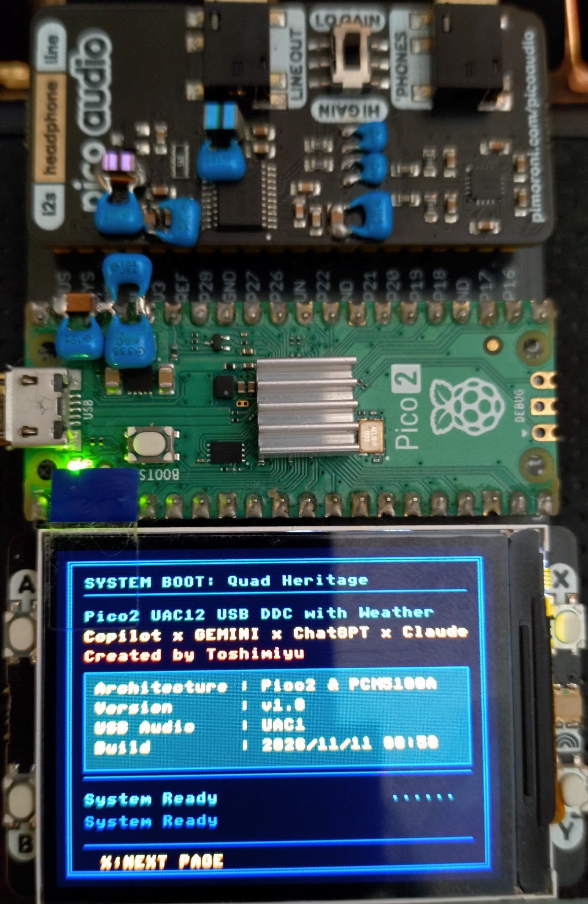
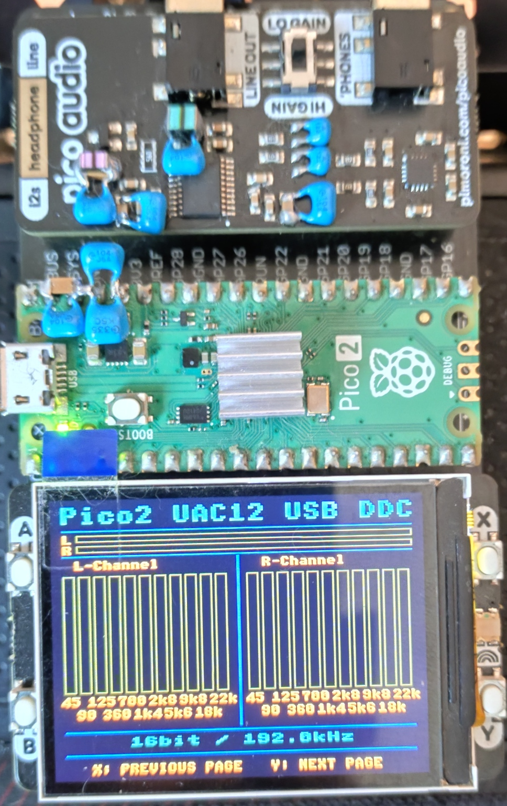
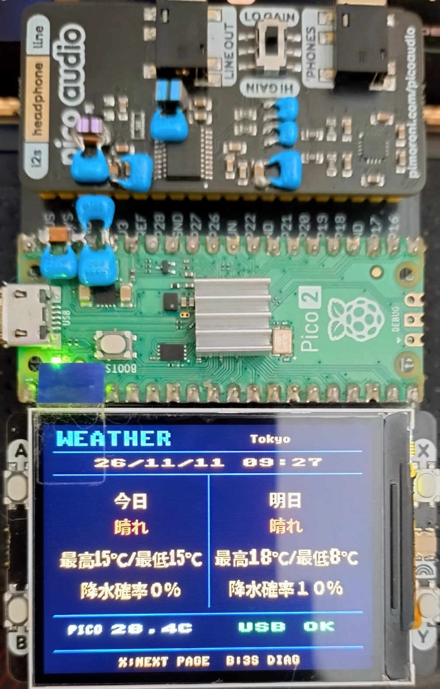
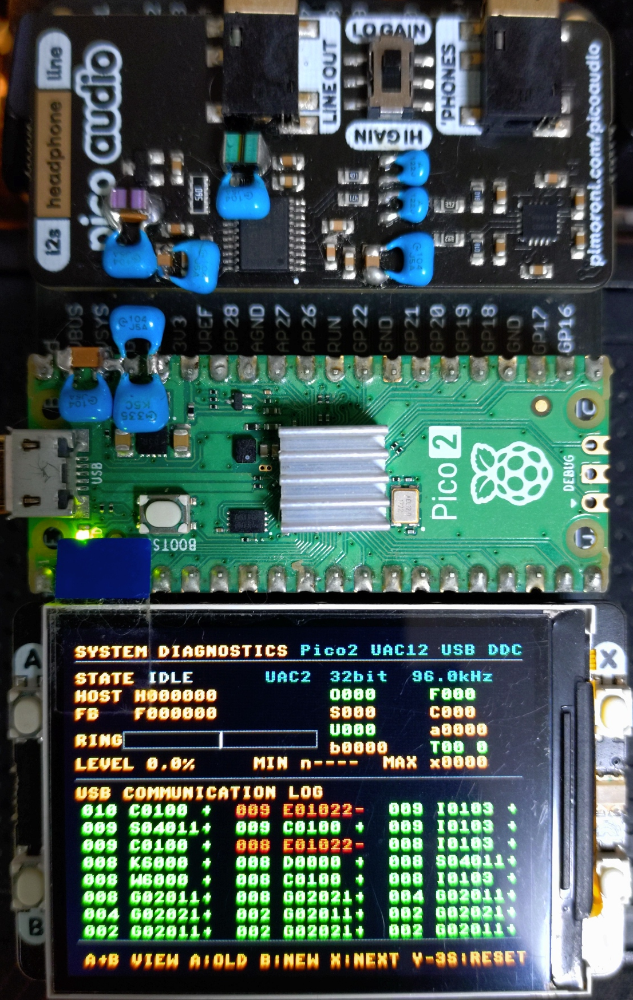

# Pico2_UAC12_USBDDC_Weather (TinyUSB UAC1/UAC2 Selectable)

[English](README_EN.md) | [日本語](README.md)

## Description

This project is a USB-DDC firmware for the RP2350 (Raspberry Pi Pico 2), derived from `Pico2_UAC12_USBDDC`.

The USB audio subsystem has been redesigned around TinyUSB, allowing USB Audio Class 1.0 and 2.0 selection at build time while sharing a common audio-processing core.

### Main Features of This Derivative

- Retains UAC1 / UAC2, I²S output, FFT visualization, and diagnostics
- Weather screen showing today's and tomorrow's forecasts, date and time, USB status, and RP2350 internal temperature
- Windows weather service sending the Japan Meteorological Agency forecast for a user-selected area and time over USB CDC
- Three-second B-button switch between the Weather and diagnostic screens
- Weather service detects USB disconnection, reconnects the COM port, and resends cached forecasts
- USB CDC diagnostic logging in diagnostic mode

### Audio and Diagnostic Features

Audio processing remains:

- No Oversampling (NOS)
- No FIR Filtering
- No Sample Rate Conversion

Before USB audio data is written to the ring buffer, its PCM sample width (16/24/32-bit) and stereo frame boundaries are checked. If an invalid format or boundary is detected, the TinyUSB OUT FIFO is cleared to resynchronize and the event is recorded in diagnostic counters and, when enabled, the CDC log. The existing state machine continues to operate; in the internal `UNDERFLOW_FATAL` state (shown as `UDF!` in the Diagnostics screen's STATE display), it waits for valid data to accumulate and resumes through the normal rebuffering sequence.

The firmware also measures abrupt changes between adjacent input PCM samples and records threshold crossings as `PCM_CLICK_CANDIDATE`. This diagnostic does not change the audio data or playback gain. Normal high-frequency signals may also be reported, so a candidate does not confirm an audible click.

Display features such as the 11-band FFT analyzer, real-time level meters, and buffer water-level monitor have been retained and improved.

**Build Verified**

- Raspberry Pi Pico SDK v2.3.1
- Toolchain 15_2_Rel1

## Version History

### v1.0 — Initial Release

This initial release adds the Weather screen and PC weather service as a derivative of `Pico2_UAC12_USBDDC`. On the actual device, recovery after unplugging and reconnecting USB during operation, switching to diagnostics and back to the Weather screen while the service is running, and viewing CDC logs in a terminal after stopping the service have been verified.

---

## Design Goals

This project was developed with the following goals:

- Simplify the audio signal path
- Remove unnecessary software DSP processing
- Avoid oversampling, FIR filtering, and sample-rate conversion in the signal path
- Improve maintainability by separating USB Audio Class specific code
- Share a common audio engine across UAC1 and UAC2
- Provide real-time diagnostics for troubleshooting

Software oversampling and FIR filtering were removed because the PCM5100A already implements internal oversampling and digital filtering.

The firmware does not perform oversampling, FIR filtering, or sample-rate conversion, but it always applies a fixed output gain ratio of 0.80 and also applies UAC1/UAC2 host volume settings (0 to -64 dB) and mute in software, changing the PCM sample values.

USB mute and unmute apply an approximately 5 ms linear gain ramp to incoming PCM. Volume changes still take effect immediately. Audio already queued in the ring and DMA is not changed, so the audible response is delayed by the queued audio. Input faults and underruns do not trigger automatic mute or fading.

---

## Features

- Selectable USB Audio Class 1.0 / 2.0
- Asynchronous feedback control using an Async Feedback Endpoint
- Starts I²S playback and PI feedback control after a sample-rate-dependent prefill of approximately 6 ms
- Real-time buffer water-level monitor
- 11-band FFT display with A-weighting
- No oversampling (NOS)
- No FIR filtering
- I²S output without oversampling, FIR filtering, or sample-rate conversion
- Low-latency I²S transfer using DMA + PIO
- RP2350 dual-core support
- PICO_AUDIO_PACK support
- Pico Display Pack 2.0 support
- Weather screen showing date and time, today's and tomorrow's conditions, temperatures, precipitation probability, USB status, and Pico internal temperature

---

## Hardware Photo

### Complete System

These photos show this project running on the hardware. The Weather screen also displays the name of the configured temperature location.

> **Important assembly note (orientation and placement)**
>
> When mounting the modules on the Treedix daughterboard, carefully check their orientation and the order of the DAC board (Pico Audio Pack) and Pico Display Pack 2.0 against the complete-system photos below. Reversing the orientation or order may cause physical interference with components such as the audio jack, preventing proper installation. Confirm the placement against the photos before wiring or soldering.

#### Boot Screen



#### Playback Screen



#### Weather Screen



#### Diagnostic Screen



Pico2 + Pico Audio Pack (PCM5100A) + Pico Display Pack 2.0

---

## Display Specification (Pico Display Pack 2.0)

After startup, GADGET MODE (the standard mode) is active. In GADGET MODE, X cycles through playback, Weather, and boot screens; the diagnostic screen is reserved for DIAG MODE and is not shown during normal screen cycling. Hold B for 3 seconds on the Weather or diagnostics screen to switch between GADGET MODE and DIAG MODE (diagnostics screen). On the Weather screen a 3-2-1 countdown is shown, and releasing B before the switch cancels it.

To reduce load during music playback, the Weather screen redraws only changed data fields and changed date/time characters; fixed labels and dividers are not redrawn except when switching pages. Dynamic field updates start at most about 24 times per second, with fills and characters split into small, spaced-out operations that run only when the audio buffer has sufficient headroom.

### Weather Screen

The screen shows date and time, today's and tomorrow's conditions, high and low temperatures and precipitation probability, USB reception status, and Pico internal temperature. Weather conditions are color-coded. Date, time, and forecasts come from the PC service; internal temperature is sampled by the Pico. Unavailable temperatures are displayed as `--`.

To the right of `WEATHER`, the selected temperature location's English name is displayed in half-width characters. It may differ from the weather and precipitation forecast area. Long names are truncated. The location name is visible on the screen, so take care when sharing photographs.

The USB status is `WAIT` before valid data is received, `OK` after reception, and `LOST` after five minutes without valid data. This indicates weather-data reception, not the USB audio state itself.

### Diagnostic Mode Controls

On the diagnostic screen:

- A : Scroll older USB log entries
- B : Scroll newer USB log entries
- A+B : Toggle between USB events and recent audio-state history
- Hold Y for 3 seconds : Reset diagnostic counters and the USB event log (a countdown is shown while holding)

USB event logging starts at boot, and the latest 64 events remain available on the Diag screen. It records USB bus resets/disconnects, descriptor requests, configuration mount/unmount, and UAC control requests. Holding Y for 3 seconds on the Diag screen clears the collected diagnostic values and USB event log. Periodic diagnostic statistics and CDC CSV output are active only in DIAG MODE. Audio playback and FFT processing continue in every display mode.

### USB CDC Diagnostic Log

The CMake option `USB_BRINGUP_LEVEL=3` enables the CDC interface used by both modes. In GADGET MODE, the CDC port receives weather commands, the diagnostic screen is hidden, and no diagnostic text is emitted. In DIAG MODE, the diagnostic screen is shown and the CDC port emits the CSV log described below; weather reception stops and incoming CDC bytes are discarded. Holding B switches the screen and CDC role together. Levels `0`, `1`, and `2` disable CDC completely. The default is level `3`.

USB startup levels are `0` (USB off), `1` (TinyUSB initialization only, no CDC), `2` (full operation, no CDC), and `3` (full operation with CDC). The default is `3` for the weather gadget. To disable CDC, specify `-DUSB_BRINGUP_LEVEL=2`.

In DIAG MODE, a PC connected to the virtual COM port receives CSV logs with milliseconds elapsed since the CDC connection. Metadata includes firmware version, prefill values, and UAC mode. Regular samples are emitted every 100 ms as `MS,FREQ,BIT_DEPTH,USB_MODE,HOST_RATE,FEEDBACK_RATE,HF_DIFF_NOW,RING_NOW,RING_MIN,RING_MAX,MAX_HF_DIFF_SESSION,MAX_HF_DIFF_STREAM,STATE`. `HOST_RATE` is estimated over a 250 ms window; `HF_DIFF_NOW` is `HOST_RATE - FEEDBACK_RATE` when both are valid and is otherwise empty. The maximum differences are tracked per CDC session and per streaming period, and `RING_MIN`/`RING_MAX` are the observed ring levels within the log interval. State transitions use `STATE,MS,FROM,TO,RATE,RING,DMA_POOL,USB_MODE`, and anomalies use `ANOMALY,MS,CODE,DETAIL,USB_MODE,STATE,RATE,RING,DMA_POOL`. Add a wall-clock timestamp on the PC if needed.

The weather service and a terminal cannot use the same COM port simultaneously. Screen-based diagnostics and returning to Weather work while the service is running, but stop the service before opening the COM port in a terminal to view CDC logs.

### PC Weather Service

The weather service requires Windows, Python 3.10 or later, and a serial dependency. An internet connection is required to fetch JMA forecasts.

Weather information currently supports locations in Japan only. Date and time are displayed in Japan Standard Time.

#### Preparing Python

Check the Python version in PowerShell:

```powershell
py --version
```

If `py` is not found or Python is not installed, install Python 3.10 or later for Windows from the [official Python website](https://www.python.org/downloads/windows/). During installation, configure Python and the launcher to be available on PATH, then reopen PowerShell and check `py --version` again. Install `pip` as well.

Task Scheduler registration also requires `pythonw.exe`. Use the following commands to check the Python executable selected by `py` and the `pythonw.exe` used by the registration script:

```powershell
py -c "import sys; print(sys.executable)"
Get-Command pythonw.exe
```

If `pythonw.exe` is not found, add its installation directory to your user PATH and reopen PowerShell. If multiple Python environments are installed, the dependency must be installed in the same environment as `pythonw.exe` when registering the task.

#### Starting the Service

From the repository root directory, install the dependency, configure the forecast area on first use, and start the service:

```powershell
py -m pip install -r requirements-weather.txt
py tools\weather_service.py --setup
py tools\weather_service.py
```

The `--setup` option opens a Japanese-language selection window. Choose the forecast office, weather and precipitation area, and temperature location from the lists obtained from JMA, then click `保存` (Save). Choose a temperature location appropriate to the selected weather area. Python's standard `tkinter` GUI library and an internet connection are required. If retrieval fails, use `一覧を再取得` (Retry) in the window.

No area is configured by default. The selection is saved outside the repository in `%LOCALAPPDATA%\Pico2WeatherService\forecast_area.json`. The configuration file and task logs can reveal the selected area; review them before sharing. Forecast requests send the selected office code to JMA.

To change the area, stop the service, run `--setup` again, and restart the service. Existing installations also require this initial area setup after updating. If a scheduled task is already registered, restart it after setup.

The service auto-detects the Pico CDC port by USB VID/PID; use `--port COM5` to select it explicitly. It sends `TIME` on connection and at each minute boundary. After the initial fetch, it fetches the JMA JSON forecast at 50 minutes and 45 seconds past each hour (Japan Standard Time), sending `TODAY` and `TOMORROW` separately. Forecast requests and transmissions avoid the minute boundary to separate them from clock updates. If temperatures are unavailable, the forecast is still sent when conditions and precipitation probability are available, and temperatures are displayed as `--`. If conditions or precipitation probability are unavailable for a date, that day's update is skipped and the previous data is retained.

Date and time use Japan Standard Time. The displayed high and low temperatures and precipitation probability are respectively the maximum and minimum temperatures and maximum precipitation probability among the forecast values available for that date. The available forecast values vary with the time of day.

The location name is obtained from the JMA observation station list and sent every minute along with the time. If retrieval fails, it is retried every 60 seconds while forecast updates continue. Existing area configurations remain usable. Displaying the name requires updating both the firmware and PC service.

On startup or reconnection it sends `TIME` first, then waits at least 5 seconds before the initial forecast fetch or cached forecast retransmission. Failed JMA requests are retried after at least 60 seconds, avoiding minute boundaries; a missed scheduled fetch runs when processing can resume. If the Pico is disconnected or the COM port is not found, it detects the loss within 1 second and retries every 2 seconds and resends the last forecast after reconnecting. While the Pico is in DIAG MODE (hold the B button for 3 seconds), it discards incoming data; after returning to GADGET MODE (the standard mode), data is applied from the next transmission.

While the Pico remains powered, it retains the last displayed data if reception is interrupted, although that data can become stale. It is not stored persistently, so after the Pico loses power or restarts, the service must send the data again.

Serial writes have a 2-second timeout and do not call the unbounded `flush()`. This avoids waiting indefinitely for transmission to finish after the Pico is unplugged; a failed write closes the port and enters reconnect mode.

To run it resident on Windows, use the Task Scheduler registration script, which starts `pythonw.exe` without a console at logon and restarts it on failure:

If `py` and `pythonw.exe` point to different Python environments, install the dependency with the `python.exe` in the same directory as `pythonw.exe` before registering the task:

```powershell
$python = Join-Path (Split-Path (Get-Command pythonw.exe).Source) "python.exe"
& $python -m pip install -r requirements-weather.txt
```

```powershell
powershell -ExecutionPolicy Bypass -File tools\install_weather_service.ps1
# To specify a port
powershell -ExecutionPolicy Bypass -File tools\install_weather_service.ps1 -Port COM5
powershell -ExecutionPolicy Bypass -File tools\install_weather_service.ps1 -Uninstall
```

The log is written to `%LOCALAPPDATA%\Pico2WeatherService\weather_service.log`. When running manually, use `--log-file` to write a log file.

Stop a manually started service with `Ctrl+C`. If started by Task Scheduler, stop and restart it as follows. Close the terminal's COM port before restarting the service.

```powershell
Stop-ScheduledTask -TaskName Pico2WeatherService
Start-ScheduledTask -TaskName Pico2WeatherService
```

Normal playback starts or resumes after approximately 6 ms of audio has accumulated in the ring at the current sample rate. While buffering, no new ring data is moved into DMA, but already queued DMA data is drained. The CSV metadata reports this time as `PREFILL_MS`. The existing CMake option `USB_AUDIO_PREFILL_FRAMES` (reported as `PREFILL_FRAMES`) is the legacy start threshold for draining queued data in non-buffering states, not the normal playback prefill amount.

Audio-state history is recorded about every 100 ms during playback. When an anomaly is detected, the approximately 4.8 seconds before and 1.6 seconds after it are retained as a frozen history for review. Detected anomalies are added to the USB log as red `E` entries: `01` buffer underflow, `02` overflow/discard, `03` USB receive FIFO resynchronization, `04` USB bus reset/disconnect, `05` playback output stop, `06` Core0 loop interval overrun, `07` Core1 loop interval overrun, `08` USB OUT packet interval of at least 3 ms, `09` PIO TX FIFO stall, `0A` DMA AHB transfer error, `0B` invalid PCM format, `0C` invalid PCM frame boundary, and `0D` click candidate. Click candidates can also be normal audio. These events also record state, rate, ring fill, and DMA-pool level in the CDC log. PIO stall monitoring starts 10 ms after output begins. Each history entry shows uptime seconds, audio state, ring-buffer level, and DMA-pool level.

### Playback Screen

The playback screen displays the following real-time information.

#### L/R Level Meter

Displays stereo audio levels in real time.

#### Independent L/R 11-Band FFT Display

Displays left and right channel frequency spectra independently with A-weighting applied.
FFT bars are updated one channel at a time, left channel first, followed by the right channel.

#### Audio Information

Displays current:

- Bit Depth
- Sample Rate (Fs)

#### Display Notes

Note: The peak indicator of the L/R level meter updates continuously according to input signal level and may appear to flicker. This is normal behavior.

If the FFT bars and peak meters do not move while music is playing, first check the volume setting on the host device, such as a smartphone or PC. The meter display follows the software gain, so an extremely low host volume or mute may result in no visible activity on the screen.

---

### Diagnostic Screen

Hold B for 3 seconds on the Weather screen to enter diagnostics, and hold B for 3 seconds again on the diagnostic screen to return to Weather. X does not navigate away from the diagnostic screen. Hold Y for 3 seconds to reset the diagnostic counters and USB event log.

#### Audio Status Information

The upper section displays current USB audio and buffer status.

##### STATE

| State | Description |
|---------|---------|
| IDLE | Stopped |
| BUFF | Buffering |
| STRM | Streaming |
| SWCH | Sample-Rate Switching |
| OVF! | Buffer Overflow |
| UDF! | Buffer Underflow |

##### HOST / FB

- HOST: Host-requested sample rate
- FB: Feedback frequency reported to host

##### Bit Depth / Sample Rate

Displayed in the format:

```text
24bit 96.0kHz
```

##### RING / LEVEL

Displays:

- Current ring-buffer fill level
- Percentage of total capacity

The white marker indicates the target buffer level.

The buffer level does not converge to a perfectly fixed value.

The PI controller continuously adjusts USB Feedback to compensate for small fluctuations in the host-side transmission rate caused by Windows, media players, USB scheduling, and other factors.

As a result, the buffer level normally exhibits small movements around the target level rather than remaining perfectly stationary.

##### MIN / MAX

Minimum and maximum buffer levels recorded during playback.

Unit:

```text
Sample Frames
```

---

### Diagnostic Counters

The right side of the diagnostic screen displays processing statistics.

| Counter | Description |
|---------|---------|
| O | Frames discarded due to ring-buffer overflow |
| F | Frames discarded during USB receive FIFO resynchronization |
| S | Frames discarded during sample-rate switching |
| C | Frames cleared during restart or stop processing |
| U | Output stoppage count detected during playback |
| a | Maximum Core0 processing interval (µs) |
| b | Maximum Core1 processing interval (µs) |
| T | DMA tail-block output count |

O/F/S/C/U are incremented when their events occur, regardless of the active screen, and show counts accumulated since reset. T counts DMA tail-block output conditions, but is incremented only while diagnostics are enabled and audio is streaming. Periodic measurements such as a/b and buffer levels are also collected only while the Diagnostics screen is active.

For stable operation:

```text
O = 0
F = 0
U = 0
```

is generally expected.

---

### USB Event Log

The bottom area displays USB communication events.

Features:

- 3 columns × 8 rows
- Up to 64 events stored
- Newest event at upper-left
- Oldest event at lower-right

Navigation:

- A button → Older events
- B button → Newer events

Displayed timestamps indicate seconds after boot.

The USB log is event-driven, not periodic. Holding Y for 3 seconds clears the diagnostic values and event log; subsequent events are recorded normally.

#### Event Symbols

| Symbol | Meaning |
|---------|---------|
| M | USB Mount |
| A | Host request for Audio Streaming Interface Alt=0 |
| I | Host request for Audio Streaming Interface Alt>0 |
| O | `usb_audio_stream_open()` |
| C | `usb_audio_stream_close()` (also used for configuration descriptor requests) |
| R | `usb_audio_apply_sample_rate()` |
| W | Sample-rate switch begin / processing in `service_switch()` |
| K | `service_switch()` completed |
| G | USB Control Request Get |
| S | USB Control Request Set / audio state transition |
| U | USB Disconnect |
| D | Device descriptor request / buffer drain complete |

Some event symbols are reused for different purposes. In particular, use the following hexadecimal fields and surrounding event sequence to distinguish `C`, `S`, and `D` events. During an alternate-setting change, `A → C → I → O` represents the normal sequence of an Alt=0 request, stream close, Alt>0 request, and stream open; it does not indicate an error.

Result suffix:

Success

```text
+
```

Failure

```text
-
```

---

### Information to Capture When Playback Stops

If playback stops or audio dropouts occur, capture the diagnostic screen immediately if possible.

The USB event log stores up to the most recent 64 events.

Please record:

- STATE
- HOST
- FB
- RING / LEVEL
- MIN / MAX
- O/F/S/C/U counters
- a/b/T counters
- Entire USB event log
- Current sample rate
- Current bit depth
- PC operating system
- Playback software
- Timestamp of occurrence
- Actions immediately before failure
- Whether playback resumed automatically
- Whether USB reconnection was required

These records help correlate:

- USB communication status
- Buffer behavior
- Audio output activity

and assist troubleshooting.

The recorded information may also be used when consulting AI services regarding fault analysis.

Note: Do not share personal information such as serial numbers.

Diagnostic information is not overlaid on the playback screen.

---

## Supported Operating Systems

The following audio playback verification details are inherited from the parent project. The weather service is intended for Windows.

- Windows 11 (verified on Windows 11 26H2. When playing in WASAPI mode with Foobar2000, match the source sample rate to the Windows 11 sample rate before playback. With ASIO4ALL or other ASIO drivers, playback works normally even if the sample rates differ. Verified with ASIO4ALL 2.22.)
- Android 16 (verified on a Sony XQ-ES44 smartphone with the paid version of Onkyo HF Player v2.15.2 and Foobar2000 for Android using the OS standard audio driver)

Onkyo HF Player supports UAC1 mode only. The parent project was verified with HF Player in UAC1 mode on the Android device listed above.

When not using Onkyo HF Player's proprietary driver and using the Android standard driver (e.g. with Foobar2000), normal operation has been verified in both UAC1 and UAC2 modes on the Sony XQ-ES44. However, after using Onkyo HF Player's proprietary driver, disconnect and reconnect the USB connector once before switching to the Android standard driver so that Android can recognize the device correctly.

---

## USB Audio Class Selection

UAC1 and UAC2 can be selected at build time using:

```cmake
USB_AUDIO_CLASS_VERSION
```

| Value | Mode |
|---------|---------|
| 1 | UAC1 |
| 2 | UAC2 |
| Not specified | UAC2 |

If prebuilt UAC1 and UAC2 firmware is available, it can also be downloaded from the releases page and flashed to the device.

### Build Commands

Build from the repository root directory.

Before building, delete the existing `build\CMakeCache.txt` to clear the CMake cache. In VS Code CMake Tools, use "Delete Cache and Reconfigure". Clearing the cache also resets manually configured values such as the SDK path, so set them again if needed. Then use one of the commands below to select and build UAC1 or UAC2.

#### UAC1 Build

```powershell
cd <repository_directory>\Pico2_UAC12_USBDDC_Weather

cmake -S . -B build -DUSB_AUDIO_CLASS_VERSION=1

cmake --build build
```

#### UAC2 Build

```powershell
cd <repository_directory>\Pico2_UAC12_USBDDC_Weather

cmake -S . -B build -DUSB_AUDIO_CLASS_VERSION=2

cmake --build build
```

Diagnostic mode is selected with the button in either UAC1 or UAC2; no separate build is needed. The default `USB_BRINGUP_LEVEL` is `3`, enabling CDC for weather reception and diagnostic logging.

After changing the setting, re-run CMake configuration and rebuild the project.

When using VS Code CMake Tools, change the CMake cache value:

```text
USB_AUDIO_CLASS_VERSION
```

to either:

```text
1
```

or

```text
2
```

and then reconfigure the project.

If the cache value is not changed, the previous configuration remains active.

If you use an existing configuration without clearing its cache and `USB_BRINGUP_LEVEL` is set to a value other than `3`, specify `-DUSB_BRINGUP_LEVEL=3`, reconfigure, and rebuild to enable weather reception and CDC diagnostic logging.

---

### Building from Windows PowerShell

If PowerShell reports:

```text
'cmake' is not recognized as an internal or external command
```

verify whether CMake is available:

```powershell
where.exe cmake
```

If no result is returned, install CMake:

```powershell
winget install Kitware.CMake
```

Restart PowerShell after installation.

If CMake is already installed but not found, add the installation directory to PATH:

```powershell
$env:Path += ";C:\Program Files\CMake\bin"
```

To make the change permanent, add the CMake installation directory to the Windows user PATH environment variable.

Verify installation:

```powershell
cmake --version
```

If a version number is displayed, configure and build the project:

```powershell
cd C:\path\to\Pico2_UAC12_USBDDC_Weather

cmake -S . -B build -DUSB_AUDIO_CLASS_VERSION=1

cmake --build build
```

For UAC2 builds, change:

```text
USB_AUDIO_CLASS_VERSION=1
```

to

```text
USB_AUDIO_CLASS_VERSION=2
```

If SDK, compiler, or Ninja-related errors occur, install the Raspberry Pi Pico extension for Visual Studio Code and use:

- Pico SDK v2.3.1
- Toolchain 15_2_Rel1

---

### Generated Firmware Files

Successful builds generate the following UF2 files:

#### UAC1

```text
build/src/Pico2_UAC12_USBDDC_Weather_UAC1.uf2
```

#### UAC2

```text
build/src/Pico2_UAC12_USBDDC_Weather_UAC2.uf2
```

To program the device:

1. Hold the BOOTSEL button.
2. Connect Pico 2 to the PC.
3. The RP2350 drive appears.
4. Copy the generated UF2 file onto the drive.

---

### Mode Specifications

#### UAC1 (`USB_AUDIO_CLASS_VERSION=1`)

- USB Audio Class 1.0
- PCM 16bit / 24bit
- 44.1kHz
- 48kHz
- 88.2kHz
- 96kHz

#### UAC2 (`USB_AUDIO_CLASS_VERSION=2`)

- USB Audio Class 2.0
- PCM 16bit / 24bit / 32bit
- Sample-rate limits depend on Full-Speed USB bandwidth

UAC-specific descriptors and control handlers are switched according to selected mode.

The following modules are shared:

- Audio Engine
- Ring Buffer
- Async Feedback
- FFT Processing
- Display System
- I²S Output

---

## Supported DAC

- Pico Audio Pack (PCM5100A)

Verified using:

- PICO_AUDIO_PACK

Note: I also own a PCM5102A-based DAC board, but it has not been tested because it is outside the scope of this project. I can check it if requested.

---

## USB Input Specifications

- USB Audio Class 1.0 or 2.0
- Async Feedback Endpoint
- Stereo PCM

### UAC1

| Bit Depth | Sample Rate |
|------------|------------|
| 16bit | 44.1 / 48 / 88.2 / 96kHz |
| 24bit | 44.1 / 48 / 88.2 / 96kHz |

### UAC2

| Bit Depth | Sample Rate |
|------------|-------------|
| 16bit | 44.1 / 48 / 88.2 / 96 / 176.4 / 192kHz |
| 24bit | 44.1 / 48 / 88.2 / 96kHz |
| 32bit | 44.1 / 48 / 88.2 / 96kHz |

### Notes

Note: The RP2350 USB Device Controller supports:

```text
Full-Speed USB only
```

Current Full-Speed limitations:

| Format | Maximum Rate |
|----------|----------|
| UAC2 16bit | 192kHz |
| UAC2 24bit | 96kHz |
| UAC2 32bit | 96kHz |

Note: 24bit/32bit 176.4kHz and 192kHz exceed the Full-Speed USB packet-size limit and are therefore not supported.

Note: Onkyo HF Player has been verified in UAC1 mode.

---

## I²S Output Specifications

- I²S
- Stereo
- 32bit PCM Format
- Input Sample Rate Follow Mode
- No Sample Rate Conversion
- No Oversampling
- I²S output without software oversampling, FIR filtering, or sample-rate conversion

### Notes

Note: The firmware applies a fixed output gain ratio of 0.80, and also applies UAC1/UAC2 volume settings (0 to -64 dB) and mute received from the host through software gain. The host volume setting therefore affects the output level.

---

## Playback Notes

- Note: Audio dropouts may occur depending on Windows audio settings
- Note: Stability depends on playback software, host performance, and system load
- Note: Stability may vary depending on the sample-rate combination

If dropouts occur:

- Switch between ASIO and WASAPI
- Reduce playback sample rate
- Reduce Windows output sample rate settings

---

## FFT Spectrum Display & Buffer Monitor

### Real-Time 11-Band FFT Spectrum Analyzer

Display Device:

- Pico Display Pack 2.0

Frequency Bands:

- 45Hz
- 90Hz
- 125Hz
- 360Hz
- 700Hz
- 1.4kHz
- 2.8kHz
- 5.6kHz
- 9.8kHz
- 18kHz
- 22kHz

### FFT Configuration

- FFT_LEN = 2048
- Window Function: Hann Window
- Weighting: A-Weighting
- RingBuffer Water-Level Monitoring
- Feedback-Control Visualization

The display system provides a real-time FFT spectrum visualization and buffer-status indication optimized for RP2350 performance and low display latency.

---

## Architecture

### Hardware

- Raspberry Pi Pico 2 (RP2350)

### Development Environment

**Build Verified**

- Raspberry Pi Pico SDK v2.3.1
- Toolchain 15_2_Rel1
- Visual Studio Code

### Display and Analysis Hardware

- Pico Display Pack 2.0
- Connected through a daughterboard

### Data Path

- TinyUSB UAC1/UAC2 class layer
- Shared audio-processing core
- DMA + PIO low-latency I²S output

### Multi-Core Processing

#### Core0

- LCD rendering
  - FFT visualization
  - Buffer water-level display
- Monitors audio inactivity in the main loop and cleans up the buffer after 500 ms
- Clock switching control
  - 44.1kHz family: 336MHz
  - 48kHz family: 360MHz
- Software audio mute (output gain control)

#### Core1

- I²S output processing
- DMA transfer handling
- FFT processing
  - Hann Window
  - A-Weighting calculation

### USB Control

- TinyUSB UAC1/UAC2 selectable layer
- Shared Async Feedback clock synchronization control

### Timing Control

- Elapsed-time monitoring in the Core0 main loop

### RAM Execution

The firmware is copied to RAM and executed from RAM during startup.

Flash clock divider setting:

```text
Divider = 3
```

Clock values from the configuration:

| Sample Rate Family | Flash Clock |
|-------------------|------------|
| 44.1 / 88.2 / 176.4kHz | 112MHz |
| 48 / 96 / 192kHz | 120MHz |

---

## Pin Assignment

### I²S Interface

| Function | GPIO |
|----------|------|
| I²S DATA | GP9 |
| I²S BCLK | GP10 |
| I²S LRCK | GP11 |

### Pico Display Pack 2.0

| Function | GPIO |
|----------|------|
| SPI / Control Interface | GP16 - GP20 |

### Navigation Buttons

| Button | GPIO | Usage |
|----------|------|------|
| X | GP14 | Next Screen |
| B | GP13 | Hold for 3 seconds on the Weather or diagnostic screen to switch modes |
| Y | GP15 | Hold for 3 seconds on the diagnostic screen to reset diagnostics |

Internal pull-up enabled.

### Diagnostic Log Buttons

| Button | GPIO | Usage |
|----------|------|------|
| A | GP12 | Older Log Entries |
| B | GP13 | Newer log entries / hold for 3 seconds to return to Weather |

Internal pull-up enabled.

### RGB LED

The Pico Display Pack RGB LED is intentionally kept off; its active-low channels on GP6-GP8 are driven high. The current firmware does not use I²C output or a DAC ENABLE signal on GP5.

---

## Build and Usage

Clear any existing CMake cache before building. See "Build Commands" for instructions.

1. Connect all hardware through the daughterboard.
2. Install the Raspberry Pi Pico Extension for Visual Studio Code.
3. Clone this repository.
4. Build the project in Visual Studio Code.
5. Hold the Pico 2 BOOTSEL button while connecting to the PC.
6. The RP2350 mass-storage device appears.
7. Copy the generated UF2 file to the device.
8. After reboot, the system is recognized as the selected USB Audio Class device (UAC1 or UAC2).

Recommended Environment:

- Pico SDK v2.3.1
- Toolchain 15_2_Rel1

---

## Development Background

The project was redesigned to simplify the audio-processing path and reduce unnecessary software processing.

Changes include:

- Removal of software oversampling
- Removal of software FIR filtering
- Simplification of signal and processing paths
- Migration from LUFA to TinyUSB
- Shared UAC1/UAC2 architecture
- Enhanced diagnostic capabilities
- Maintenance of FFT visualization and clipping protection

The PCM5100A already contains internal oversampling and digital-filter processing.

For this reason, the firmware avoids software oversampling, FIR filtering, and sample-rate conversion. However, software gain control is applied for volume and mute.

The RP2350 is operated in an overclocked configuration.

The verified test system was equipped with a heatsink during evaluation.

## Tested Environment

### Hardware

The following audio playback environment is inherited from the parent project.

- Raspberry Pi Pico 2 (RP2350)
- Pico Audio Pack (PCM5100A)
- Pico Display Pack 2.0
- Sony XQ-ES44 smartphone

### Software

**Windows**

- Windows 11 26H2
- Foobar2000 v2.26.1 (x64)
- ASIO4ALL 2.22

**Android**

- Android 16
- Onkyo HF Player v2.15.2
- Foobar2000 for Android v2.26.1 (ARM, OS standard audio driver)

---

## License

MIT License

Copyright (c) 2026 Toshimiyu

---

## References

- USB Audio Class 1.0 Specification
- USB Audio Class 2.0 Specification
- TinyUSB Project
- Raspberry Pi Pico SDK v2.3.1
- RP2350 Documentation
- PCM5100A Datasheet
